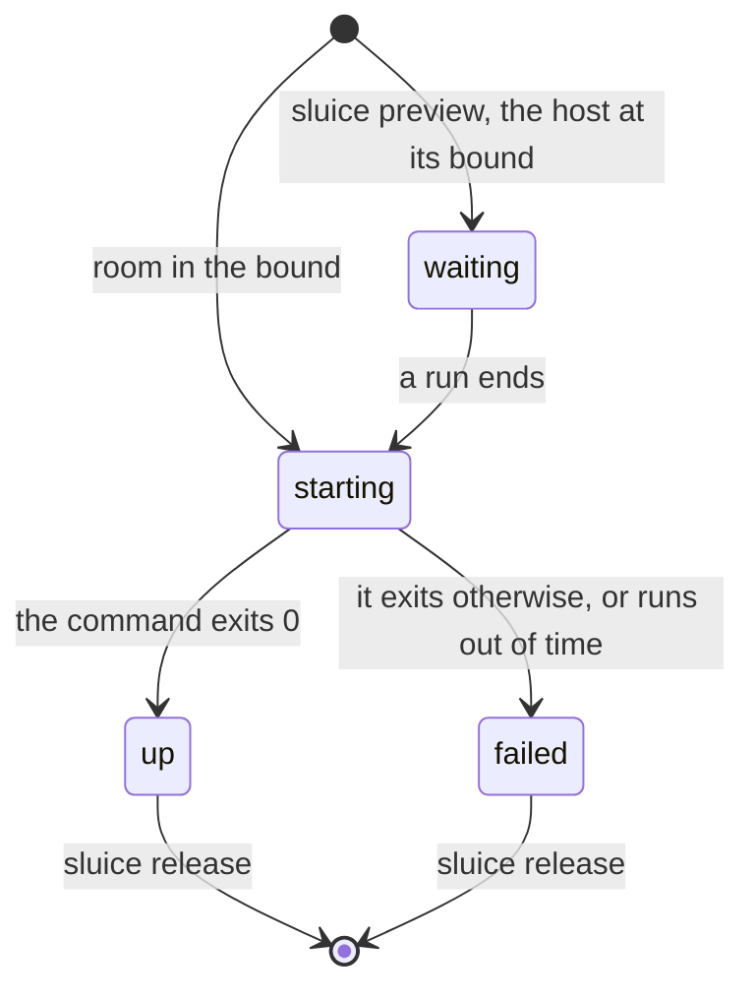
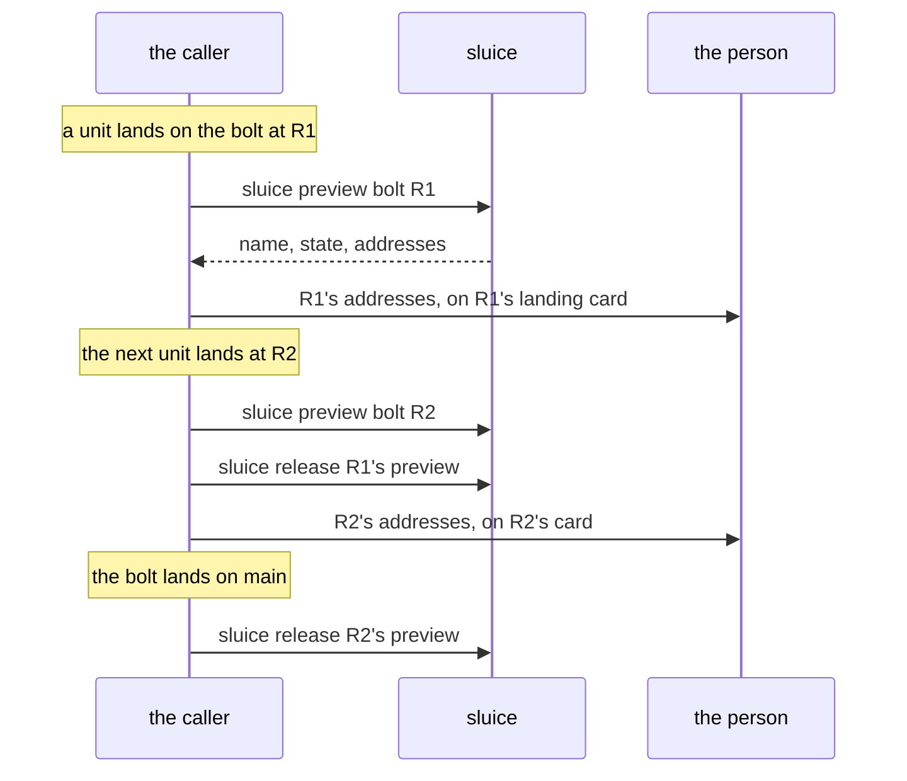

# Previews

The design below is under review in `design/sluice/proposals/
previews-1.md`. It holds on one machine.

A person who checks a bolt's work wants it running. A preview gives
them that without anyone keeping a worktree of the branch. sluice makes
a place at a revision the branch has landed, and the repository's own
command brings its stack up there on the fakes its checks already use.
The caller hands the person the addresses to open (98). The caller
also ends it (101).

## Three places, three owners

sluice knows two kinds of place already. It makes a candidate's place
and releases it once the verdict is read (25). A session's place is the
session's own; sluice equips it for the session's runs and releases it
only when the session or its driver asks (95). A preview is the third:
sluice makes it, as it makes a candidate's, and releases it only
when its caller asks, because nothing in sluice knows when a person has
finished looking.

| place | made by | released by |
|---|---|---|
| a candidate's | sluice (33) | sluice, once the verdict is read (25) |
| a session's | its driver | `sluice release`, at the session's or driver's asking (95) |
| a preview | sluice, at a landed revision (98) | `sluice release <preview>`, at the caller's asking (101) |

A preview's revision is one the branch has landed, so a person only
ever looks at a combination the gate passed (22, 98). A candidate's
revision, or a session's head that has not landed, has no preview
(S35). The caller names the revision, so a preview asked for as the
branch moves again still shows the revision the caller meant. A
revision has one preview on a host, whichever branch it was asked
through (100).

Each preview keeps its record in `.previews/`, apart from the other
places' records, so a sluice that predates previews never reads one.

## What runs in it, and under what

The preview's command is the repository's, named in `[preview]` of the
previewed revision's policy. It runs once, under the host's executor,
and its process group ends when it exits (66). What it hands to another
process, a container engine's containers or a process manager's
servers, stays until the preview is released (98). sluice starts no
service by it (31): the repository's own tools keep the stack.

What the stack is and how it comes down are the previewed revision's:
the command, the ports, the caches and the release command are read
from that revision, since they describe its stack. What the command may
use and reach is the branch's now: the executor, the limits and the
time limit, or `[preview] timeout`, are read from the branch's current
revision (27, 56). A gate reads nothing of either; a preview gates
nothing (103).

## Names and addresses

Several previews, candidates and session runs share one host, each
with servers a person opens by name through a local proxy. sluice gives
a preview a name for each port, as it gives each port (31, 99), so no
two places alive on the host share either.

A name is one DNS label, `<port>-<rev7>--<branch>--<repository>`, at
most 63 characters. A longer one is cut and ends in a short hash of the
whole, with the port and the revision kept; a name another preview
holds takes the revision's first twelve characters instead. One label
holds under a wildcard certificate and a `*.localhost` redirect, each
of which covers one.

The command receives `SLUICE_NAME_<NAME>` beside `SLUICE_PORT_<NAME>`,
with `SLUICE_BRANCH` and `SLUICE_REVISION`. The policy writes each
address as a template over the names and ports, and sluice fills it in
as soon as the preview is asked for, before its stack is up (99, S30).

```toml
[preview]
command   = "moon run app:preview"
addresses = { web = "https://{name.web}.localhost" }
```

Under portless, the command routes the name to the port with `portless
alias "$SLUICE_NAME_WEB" "$SLUICE_PORT_WEB"`, and the release command
removes the alias. sluice names no proxy and never contacts an address.

## The life of a preview

A preview is in one of four states, read from its record and its run
every time it is asked about, never kept by a process.



`sluice preview <branch> <revision>` makes the place and then waits for
room in the host's bound, as a session run does, never taking the
share the host reserves for candidates (102). Ctrl-C while it waits
leaves the preview `waiting`; the next asking takes it up with the same
names and ports. Once the command starts, `sluice preview` returns with
the addresses, or with `--wait` once the command has ended. The command
counts against the bound while it runs; a held preview counts against
nothing (102).

A preview whose command fails, or runs out of time, is released at
once: its release command runs, its checkout goes and its ports and
names are freed. It stays listed as `failed`, holding nothing, with the
end of what its command printed, until its caller releases it (101,
S33). sluice also releases a preview whose checkout no longer exists.
No round, landing or submission ends a preview that is up (101).

Nothing of a preview is a result: its command is never recorded as a
run, read by a gate, or waited on by an entry (103).

## The caller's side

sluice knows no bolt and no card. A caller such as crew or flywheel
holds both, and owns each preview's life.



One preview per landing: the card's link always shows exactly the
revision the card names, and a new landing gets a new preview with new
names (S31). A caller that crashed asks again and gets what it asked
for the first time (100, S32). After a crash the caller lists the
host's previews with `sluice previews` and releases each whose revision
is on no live card. A caller that forgets one leaks a stack until that
reconciliation finds it, since sluice ends nothing that is up.

## A preview and a deployment

A preview is cheap: the repository's own stack on its fakes, up in
seconds to a minute, many at once, on the host it runs on. It answers
whether the work behaves, on the stack the gate's checks started, so
what the person sees is what was tested.

It does not answer whether the work deploys and runs in the real
environment. Infrastructure code, permissions, the identity provider's
real settings, outside integrations and performance are outside what
the fakes model. That takes a deployment by a delivery tool holding the
environment's credentials, which sluice never holds. sluice decides what
lands and shows what landed running; putting a revision into a real
environment is another tool's.

| the work touches | the caller asks for |
|---|---|
| behavior, pages, flows, data the fakes model | a preview, on every landing |
| infrastructure code, permissions, identity settings, outside integrations, performance | a deployment from the delivery tool, once the bolt is ready for main |

A caller with both holds one idea for each: an environment for one
revision, linked to its card, replaced on the next landing and ended
when the bolt lands. Only the provider differs.
