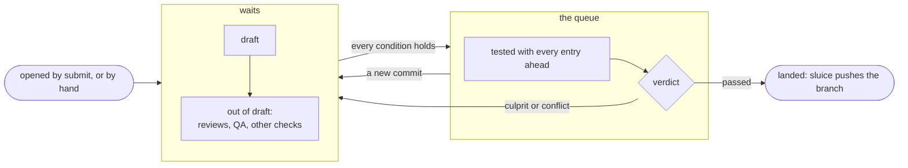
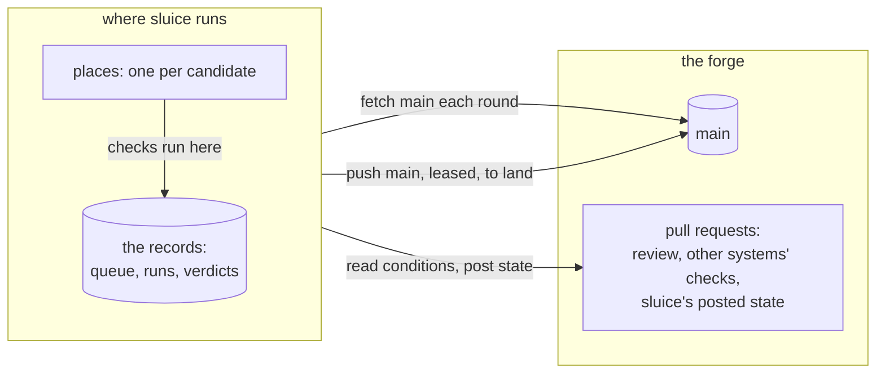
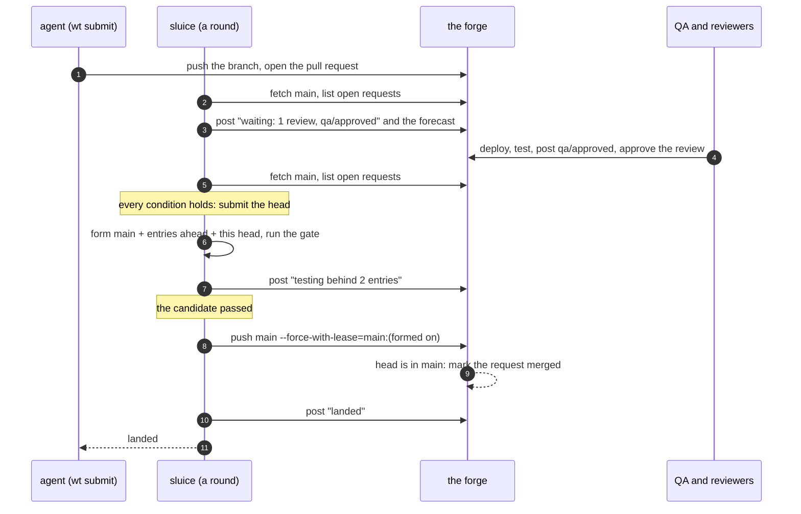
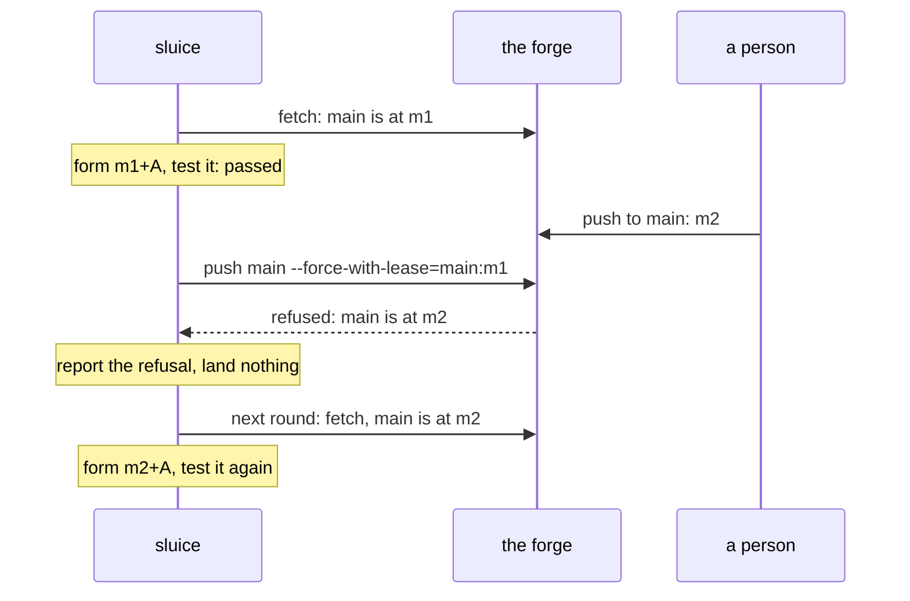
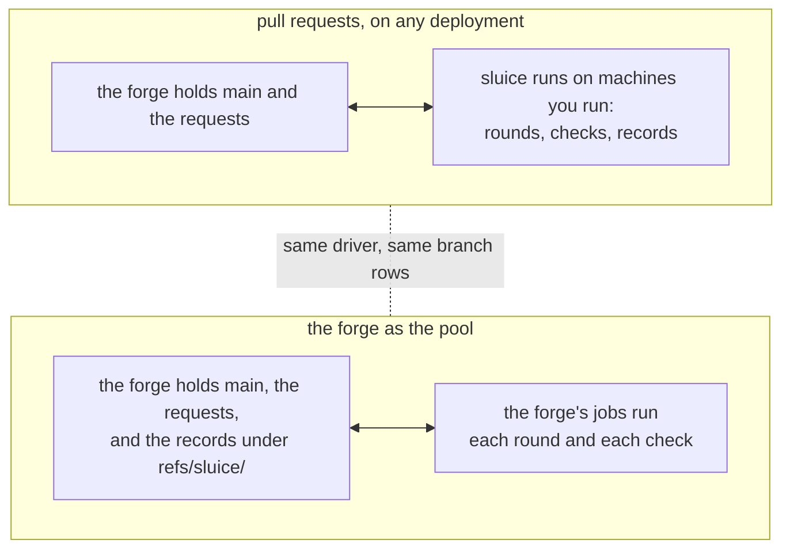

# A branch on a forge, and pull requests

The design below is under review in `design/sluice/proposals/
pull-requests-1.md` and is not yet built. It holds on one machine and
on many, with any executor: the checks run where sluice runs them.

A repository's shared branch often lives on a forge such as GitHub,
and its work arrives as pull requests that wait for review, for a QA
team, or for other systems' checks. sluice keeps such a branch in step
with the forge, and treats a pull request as a submission's page.
People review it there, other systems post their checks there, and
sluice shows there what the queue is doing with it.

## Two stages: waiting, then the queue

A pull request **waits** while it is a draft, or while a condition the
branch's policy names does not yet hold. A condition is an approving
review on the current head, or a check another system posts on the
head by name, such as `qa/approved` from a QA team that tests a
deployment of the request. Work is submitted only once nothing holds it
back, which is where the statement leaves approval (27).

When the request is out of draft and every condition holds, the driver
submits its head, and the entry joins the branch's one chain (8). From
then on it is an entry like any other: tested with everything ahead of
it (10), landed in order (22), or removed as culprit (17) or conflict
(12).



A request never waits inside the queue. The chain lands in order, so an
entry held for a person's approval would hold every entry behind it,
and a refusal would form every candidate behind it again. Holding the
request until its conditions hold keeps everything in the queue ready
to land the moment it passes.

What a waiting request learns early is its forecast (64). Each round
forms the candidate the request would get if it were submitted now,
behind everything in the queue, and posts the result on it. The result
reads "merges without conflict behind two others", or names the request
it conflicts with. A forecast
runs no check and moves nothing.

## What lives where

The branch and the pull requests live on the forge. The queue, its
candidates, their runs and their verdicts live where sluice runs. On
one machine that is the machine's own files (C.6), and only the branch
is pushed. The forge never holds the queue's state, so it never holds
a second copy that could disagree with the records.



## A request from submit to landed

An agent's `wt submit` pushes its branch and opens the pull request.
A person can open one by hand instead, from any branch of the
repository; the next round finds it the same way. A request from a
fork is never submitted.



A waiting `wt submit` reports the same states the request shows, and
returns when its entry lands or is removed. An agent that should not
wait through a day of review submits with `--no-wait` and reads the
state later.

## When the branch moves outside the queue

Only sluice's identity may move the branch on the forge, by the forge's
own rules (1). While that identity is a person's own account, that
person's direct pushes and merge-button clicks still get through, and
sluice treats each one as the branch moving under its queue. The
landing's push names the revision the candidate was formed on, and the
forge refuses it when the branch has moved. sluice reports the refusal
and never retries it blind (24); the next round forms the chain again
on the new revision (S8).



When sluice lands entries exactly as they were tested, the entries
behind them keep their verdicts; only a move from outside sends them
back to be tested.

## The policy

The branch's policy, read from the branch's own revision (56), names
the remote the branch lives on and the conditions a request meets
before it is submitted:

```toml
[branches.main]
remote = "origin"            # fetched every round; landed by a push

[branches.main.pull_requests]
reviews = 1                  # approving reviews on the current head
checks = ["qa/approved"]     # checks other systems post on the head
```

The conditions decide when work is submitted. They never change how it
is tested: the gate is still the checks sluice runs (27). A branch with
no `remote` stays a local branch, as a bolt's branch does.

## Beside a forge's job service

A forge's job service, GitHub Actions for one, can also be the place
sluice's checks and rounds run: the forge as the pool ([Many
hosts](many-hosts.md)). That deployment uses the driver and the branch
above as they stand and changes only where the work happens.


